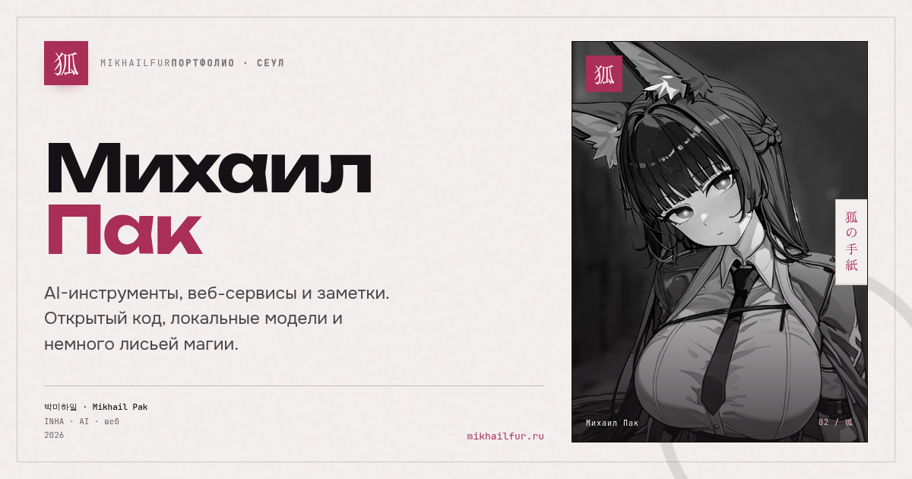

# mikhailfur

Портфолио Михаила Пака: AI-инструменты, веб-проекты и заметки из Сеула. Один длинный лендинг с терминалом, галереей, аркадой и локальным 2FA-блокнотом. Интерфейс на русском, английском и корейском.



## Что внутри

- **Терминал** с командами `help`, `about`, `works`, `stack`, `notes`, `gallery`, `play`, `music`, `lang`, `message`, `2fa`, `clear`. История и автодополнение по Tab.
- **Miyabi**, лиса-ассистент: чат через OpenRouter, опциональный голос через MiniMax T2A. Может открыть нужную секцию или включить аркаду.
- **Галерея Civitai** с возрастным гейтом 19+, фильтрами, поиском, лайтбоксом и копированием промпта.
- **Аркада**: змейка, Wallz и анонимная чат-рулетка на Upstash Redis. Сообщения живут час.
- **Заметки** из Markdown с frontmatter, архивом, ридером и локализованными версиями.
- **2FA-блокнот**: TOTP-коды считаются в браузере, секреты не уходят на сервер. Страница закрыта от индексации и отдаётся с отдельным CSP.
- **Командная палитра** по `Cmd/Ctrl + K`: секции, заметки, языки, GitHub, Telegram, запуск игр.
- **Мелочи**: возрастной гейт, лепестки сакуры, звук, ночные секции, страницы 404/500/503, режим обслуживания.

## Стек

Next.js 16 (App Router, Turbopack), React 19, TypeScript, Tailwind CSS 4, Radix UI, Upstash Redis, Vercel Analytics (опционально).

Шрифты: Unbounded, Onest и JetBrains Mono через `next/font`; Black Han Sans, Gothic A1 и Zen Old Mincho через Fontsource. Для хангыля отдельная пара Black Han Sans / Gothic A1, для японских акцентов Zen Old Mincho.

## Быстрый старт

Нужны Node.js 22.13 или новее и pnpm.

```bash
git clone https://github.com/mikhailfur/mikhailfur.git
cd mikhailfur
cp .env.example .env.local
pnpm install
pnpm dev
```

Сайт откроется на [http://localhost:3000](http://localhost:3000). Без переменных окружения работают все статические секции, терминал, галерея и 2FA. Чату Miyabi нужен ключ OpenRouter, чат-рулетке в продакшене нужен Upstash.

## Переменные окружения

Скопируй `.env.example` в `.env.local` и заполни то, что нужно. Пустые публичные ссылки просто не показываются в контактах.

| Переменная | Зачем |
| --- | --- |
| `NEXT_PUBLIC_SITE_URL` | Канонический адрес сайта для метаданных и OG-картинки. По умолчанию `https://mikhailfur.ru`. |
| `NEXT_PUBLIC_GITHUB_USERNAME` | GitHub-аккаунт для списка проектов. По умолчанию `mikhailfur`. |
| `NEXT_PUBLIC_GITHUB_URL`, `NEXT_PUBLIC_TELEGRAM_URL` | Основные ссылки в контактах и палитре. |
| `NEXT_PUBLIC_DISCORD_URL`, `NEXT_PUBLIC_KAKAOTALK_URL`, `NEXT_PUBLIC_VK_URL`, `NEXT_PUBLIC_TWITCH_URL`, `NEXT_PUBLIC_XBOX_URL` | Дополнительные контакты. Оставь пустыми, если сервиса нет. |
| `CIVITAI_USERNAME` | Автор работ в галерее. `NEXT_PUBLIC_CIVITAI_USERNAME` работает как запасной вариант. |
| `OPENROUTER_API_KEY` | Чат Miyabi и `pnpm article:translate`. |
| `OPENROUTER_MODEL` | Модель OpenRouter. По умолчанию `google/gemma-4-31b-it`. |
| `MINIMAX_API_KEY` | Голос Miyabi через MiniMax T2A. Без ключа чат работает текстом. |
| `MINIMAX_VOICE_ID`, `MINIMAX_TTS_MODEL` | Голос и модель TTS. |
| `TELEGRAM_BOT_TOKEN`, `TELEGRAM_CHAT_ID` | Команда `message` в терминале. Бот должен уже иметь чат с тобой. |
| `YANDEX_MUSIC_TOKEN` | Плашка «сейчас играет» из Yandex Music. |
| `UPSTASH_REDIS_REST_URL`, `UPSTASH_REDIS_REST_TOKEN` | Лимиты Miyabi и общий чат-рулетки. В разработке рулетка работает в памяти процесса. |
| `MAINTENANCE` | `true` включает страницу 503 для всех маршрутов. Кука `devMode=true` обходит режим. |
| `NEXT_PUBLIC_ANALYTICS` | `true` включает Vercel Analytics. Работает только на Vercel, по умолчанию выключено. |

Приватные ключи не попадают в клиентский бандл: обращения к OpenRouter, MiniMax, Telegram и Yandex идут через route handlers в `src/app/api`.

## Скрипты

```bash
pnpm dev            # разработка
pnpm build          # production-сборка
pnpm start          # запуск собранного сайта
pnpm lint           # ESLint
pnpm typecheck      # tsc --noEmit
pnpm article:translate  # перевести недостающие статьи на en и ko
```

`article:translate` читает `.env.local` или `.env`, берёт русские файлы `src/data/articles/*.ru.md` и создаёт `*.en.md` / `*.ko.md`, если их ещё нет. Нужен `OPENROUTER_API_KEY`.

Отдельный редактор статей остался в `tools/article-editor/index.html`. Это автономная HTML-страница: открой её в браузере, заполни метаданные и скачай готовый Markdown. Сервер и сборка ей не нужны.

## Маршруты

| Путь | Что это |
| --- | --- |
| `/` | Портфолио: hero, about, works, stack, notes, gallery, play, terminal, contact. |
| `/2fa` | Локальный TOTP-блокнот. `noindex`, отдельный CSP, без аналитики. |
| `/play` | Редирект на `/#play`. |
| `/error-pages/[code]` | Страницы 404, 500, 501, 502, 503. |
| `/api/projects` | Свежие репозитории GitHub с fallback-списком. |
| `/api/civitai` | Работы из Civitai с возрастным рейтингом. |
| `/api/miyabi` | Чат и TTS Miyabi. |
| `/api/music` | Текущий трек Yandex Music. |
| `/api/message` | Сообщение в Telegram из терминала. |
| `/api/stranger-chat` | Комнаты анонимной чат-рулетки. |

## Деплой

1. Залей репозиторий на GitHub и импортируй его в Vercel.
2. Framework preset: Next.js. Install command: `pnpm install`. Build command: `pnpm build`. Node.js 22.
3. Добавь переменные из `.env.example`. Минимум для полноценного сайта: `NEXT_PUBLIC_SITE_URL`, `NEXT_PUBLIC_GITHUB_USERNAME`, `CIVITAI_USERNAME`. Для Miyabi: `OPENROUTER_API_KEY`. Для чат-рулетки в продакшене: `UPSTASH_REDIS_REST_URL` и `UPSTASH_REDIS_REST_TOKEN`.
4. Если нужна аналитика, поставь `NEXT_PUBLIC_ANALYTICS=true`. На других хостингах Vercel Analytics не работает.
5. Для своего домена поменяй `NEXT_PUBLIC_SITE_URL` и пересобери проект.

Локальная проверка production-сборки:

```bash
pnpm build
PORT=3001 pnpm start
```

## Данные

- **Проекты** приходят из GitHub API и кэшируются на час. Если API недоступен, показывается список из `src/data/projects.ts`.
- **Статьи** лежат в `src/data/articles/` как Markdown с frontmatter. Лоадер собирает русскую, английскую и корейскую версии по суффиксу `.ru.md`, `.en.md`, `.ko.md`.
- **Галерея** тянет работы с Civitai по имени автора. 19+ контент размыт до подтверждения возраста, выбор хранится в `localStorage`.
- **Тексты интерфейса** собраны в `src/data/site.ts`. Три словаря типизированы от русского, так что пропущенный ключ ловится на `pnpm typecheck`.

## Приватность и безопасность

2FA-блокнот хранит секреты только в `localStorage` браузера. Коды считаются через Web Crypto, на сервер ничего не отправляется. Страница `/2fa` отдаётся с `no-store`, `no-referrer`, запретом фреймов и строгим CSP.

Галерея содержит взрослые работы. Гейт 19+ не защищает детей. Это честная проверка возраста для посетителя. Не отключай размытие на публичных экранах.

Пароли, токены и ключи не коммить. `.env`, `.env.local`, `.data` и `.vercel` уже в `.gitignore`.

## Структура

```text
src/
  app/                 маршруты, metadata, API, proxy
  components/
    site/              секции лендинга, палитра, терминал, Miyabi
    brand/             лиса и энсо
    ui/                Radix-обёртки
    twofa/             TOTP-блокнот
    arcade/            игры
  data/                тексты, проекты, статьи, промпты
  lib/                 i18n, чат-рулетка, утилиты
  styles/              токены и CSS по слоям
  types/               общие типы
  utils/               звук
public/
  avatar.png           портрет
  og.png               OG-картинка 1200×630
  articles/            вложения к статьям
  texture/             бумажная текстура
scripts/
  translate-articles.mjs
tools/
  article-editor/
    index.html
```

## Контакты

- GitHub: [github.com/mikhailfur](https://github.com/mikhailfur)
- Telegram: [@dataisnotfound](https://t.me/dataisnotfound)
- Сайт: [mikhailfur.ru](https://mikhailfur.ru)

## Лицензия

GPL-3.0. Подробности в [LICENSE](./LICENSE).
